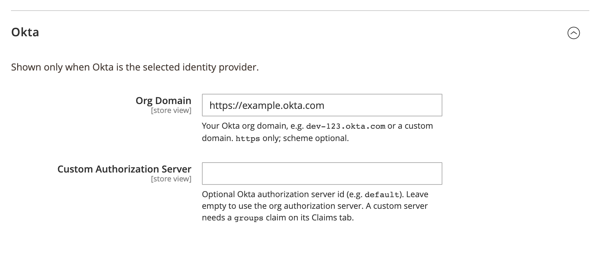

# DmLab_CustomerSsoOkta

> Okta login for the Magento 2 storefront.

[](https://github.com/dmlab-work/module-customer-sso-okta/actions/workflows/ci.yml) [](https://codecov.io/gh/dmlab-work/module-customer-sso-okta) [](https://packagist.org/packages/dmlab/module-customer-sso-okta) [](https://packagist.org/packages/dmlab/module-customer-sso-okta) [](https://packagist.org/packages/dmlab/module-customer-sso-okta) [](LICENSE) 

Shoppers sign in to your store with their Okta account instead of creating another password.
The first sign-in creates the store account, or links an existing one by verified email.
Okta groups can place customers in Magento customer groups (e.g. wholesale); password login can stay on. Free, no user cap.



## Install

```bash
composer require dmlab/module-customer-sso-okta  # also installs Customer SSO and the SSO engine
bin/magento module:enable DmLab_SsoCore DmLab_CustomerSso DmLab_CustomerSsoOkta
bin/magento setup:upgrade
```

## Requirements

- Magento 2.4.7+ · PHP 8.2–8.5
- Storefront on HTTPS (the Okta redirect URI)
- An Okta OIDC Web Application (below)

## Set up Okta

### Create the Okta app

Okta Admin Console → **Applications → Create App Integration**:

1. Sign-in method **OIDC - OpenID Connect**, application type **Web Application**.
2. **Sign-in redirect URI**: `https://<store-host>/customersso/sso/callback` — must exactly match the storefront URL used at runtime.
3. Save, then copy the **Client ID** and **Client secret**.
4. **Groups claim** (for Okta group → customer group mapping; without it customers get the default group):
   - **Org server** (Custom Authorization Server empty): app → **Sign On → OpenID Connect ID Token → Groups claim filter**, `Matches regex .*`. The `groups` scope is requested automatically.
   - **Custom server**: **Security → API → Authorization Servers → `<server>` → Claims → Add Claim** — name `groups`, include in ID Token, Always, value type Groups, filter `Matches regex .*`. The `groups` scope is not requested (custom servers reject it).

### Configure Magento

Admin → Stores → Configuration → **DMLab → Customer SSO** (store-scoped, can differ per store view).

**General** (`dmlab_customer_sso/general/*`):

| Field | Value |
|---|---|
| Enable Customer SSO | Yes |
| Identity Provider | Okta |
| Client ID | from the Okta app |
| Client Secret | from the Okta app |

**Okta** (`dmlab_customer_sso/okta/*`, shown when Okta is selected):

| Field | Value |
|---|---|
| Org Domain | e.g. `dev-123.okta.com` — `https` only, scheme optional; `http://`, paths (e.g. `/oauth2/default`), queries, fragments and credentials are rejected |
| Custom Authorization Server | optional server id (e.g. `default`); empty = org server |

Discovery URL: `https://<domain>/.well-known/openid-configuration`, or
`https://<domain>/oauth2/<auth-server>/.well-known/openid-configuration` with a custom authorization server.

Creating a store account, or linking an existing one by email, requires Okta to assert `email_verified=true`.
Account linking, password login and group → customer-group mapping are configured in
[customer-sso](https://github.com/dmlab-work/module-customer-sso#configuration).

## Hyvä

The login button comes from customer-sso; its default template is Luma markup. customer-sso ships a Hyvä (Tailwind)
template, enabled by a manual layout edit in the theme's `Magento_Customer/layout/customer_account_login.xml`:

```xml
<referenceBlock name="dmlab.customer.sso.button" template="DmLab_CustomerSso::login/sso-button-hyva.phtml"/>
```

The checkout and minicart popup buttons are Luma only.

Pairs with [customer-sso](https://github.com/dmlab-work/module-customer-sso) (installed automatically), [customer-passkey](https://github.com/dmlab-work/module-customer-passkey) (passkey sign-in) and [admin-sso-okta](https://github.com/dmlab-work/module-admin-sso-okta) (Okta login for the admin panel).

## Architecture

An Okta `ProviderPreset` (discovery URL, scopes, groups claim, button branding) registered into customer-sso's
`PresetRegistry` via `etc/di.xml`, plus store-scoped config `dmlab_customer_sso/okta/*`. The OIDC protocol lives in
sso-core, the storefront login flow in customer-sso.

The preset is duplicated from admin-sso-okta, not shared: the common surface is small (org-domain normalizer,
discovery-URL builder, scopes, groups claim) and the copies differ in config section, scope and logo asset.
A shared `sso-okta` module is extracted only if the copies grow or drift.

## License

[OSL-3.0](LICENSE) © DMLab. Commercial licensing and support: <https://dmlab.work>.
